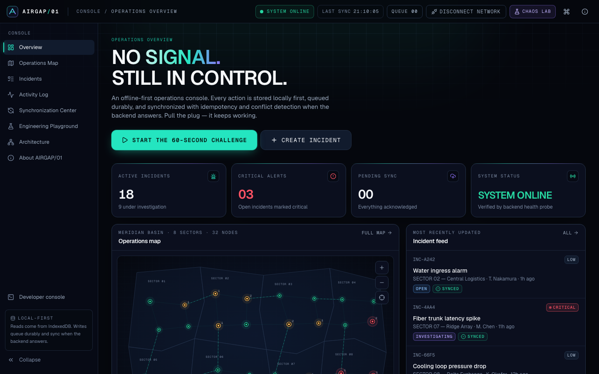
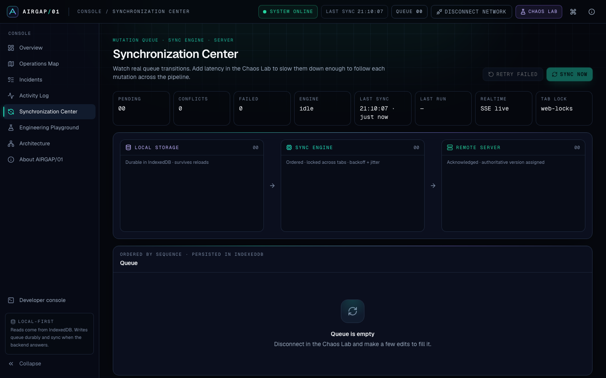
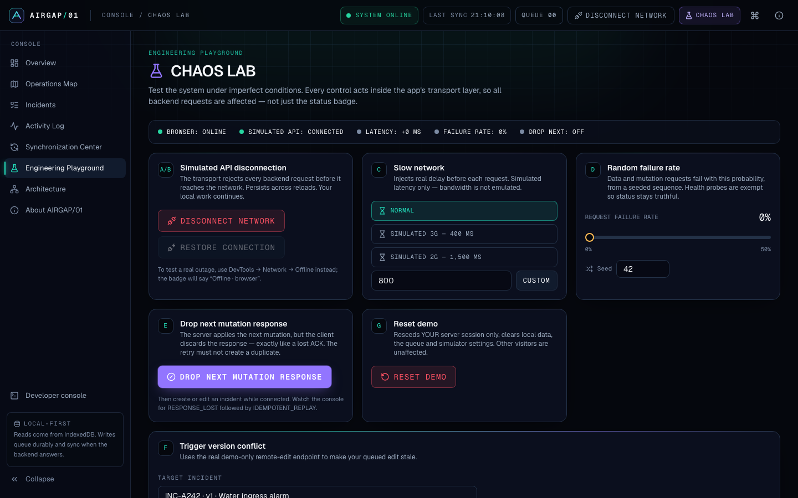
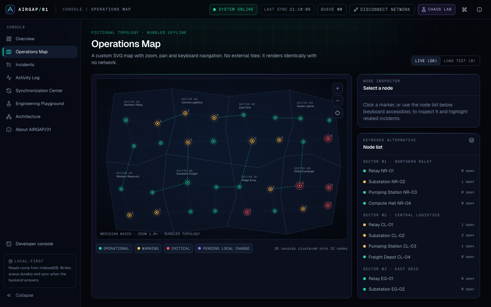
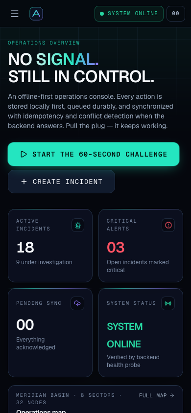

# AIRGAP/01

**NO SIGNAL. STILL IN CONTROL.**

AIRGAP/01 is a fictional infrastructure operations console built to show how a
frontend stays useful when connectivity is intermittent, slow or absent.
Operators monitor incidents on a live map, create and edit them, and keep
working with no network. When the backend is reachable again, a durable queue
synchronizes every change: in order, with idempotency keys, and with
human-resolved version conflicts.

It is an independent engineering demonstration. It is not affiliated with
Sarvam AI. All infrastructure, locations, operators and incidents are
fictional.



| Sync Center                                            | Chaos Lab                                           |
| ------------------------------------------------------ | --------------------------------------------------- |
|  |  |
| **Operations map**                                     | **Mobile**                                          |
|           |  |

## What it does

- **Local-first incident management.** Create, view, edit, change status and severity, assign, delete, search, filter and sort incidents. Every read comes from IndexedDB, and every write lands there first.
- **A real offline mode.** A Workbox service worker precaches the app shell, so the console reloads with DevTools set to Offline. Data, the queue, the event cursor and the session all persist in IndexedDB.
- **A durable mutation queue.** It is ordered, survives reloads, and gives each mutation a stable idempotency key. Updates are rebased onto server versions, and a delete of a never-sent create is cancelled locally.
- **A sync engine.**
  - It acts on real backend reachability (health probes and request outcomes), not `navigator.onLine`.
  - It processes one mutation at a time and blocks per entity.
  - It retries with exponential backoff and jitter, up to a limit, and shows permanent failures to the user.
  - It holds a cross-tab lock (Web Locks, with a localStorage-lease fallback) and uses BroadcastChannel.
  - It recovers syncs interrupted by a reload or crash.
- **Server guarantees.** The server is Fastify plus SQLite. Each write is applied in the same transaction as its idempotency record, and optimistic concurrency returns a structured 409. Writes are validated with Zod. Each visitor gets an isolated demo session, and rate limits and CSP are in place.
- **Conflict resolution.** The SYNC CONFLICT DETECTED dialog shows a field-level diff and offers three choices: **Keep my changes**, **Accept server version** and **Review & merge**.
- **Chaos Lab.** It can simulate an API disconnect (which persists across reloads), add latency (3G / 2G / custom), inject seeded random failures (0–50%), drop the next mutation response, trigger a version conflict and reset the demo. Every control acts inside the transport.
- **Sync visualizer.** Mutation cards move from local storage to the sync engine to the remote server as their real queue state changes.
- **LOAD TEST / 1000.** It loads 1,000 deterministic records into a separate table. Queries use IndexedDB indexes, the list is virtualized, and the performance panel shows measured timings.
- **Extras.** A real-time activity feed (SSE with a polling fallback and cursor catch-up), a connection timeline, a developer event console, a ⌘K command palette, an architecture viewer and a guided **60-second challenge**.

## Technology

| Layer    | Stack                                                                                                                     |
| -------- | ------------------------------------------------------------------------------------------------------------------------- |
| Frontend | React 19, TypeScript (strict), Vite 7, Tailwind CSS 4, Radix primitives, cmdk, Motion, Lucide, Recharts, TanStack Virtual |
| State    | Redux Toolkit (ephemeral/URL state), Dexie 4 on IndexedDB (durable data), live queries                                    |
| Offline  | vite-plugin-pwa (Workbox precache), Web Locks, BroadcastChannel, Server-Sent Events                                       |
| Backend  | Node.js ≥ 22.13, Fastify 5, SQLite via built-in `node:sqlite`, Zod 4, Helmet, rate limiting                               |
| Testing  | Vitest, React Testing Library, MSW, fake-indexeddb, Playwright                                                            |
| Tooling  | pnpm workspaces, ESLint 9, Prettier, Docker, GitHub Actions                                                               |

> The SQLite driver is Node's built-in `node:sqlite`, which works synchronously like better-sqlite3. It needs no native compilation, so installs and Docker builds stay simple on any Node version.

## Getting started

Requirements: Node.js 22.13 or newer (24 recommended) and pnpm 10.

```bash
pnpm install
```

```bash
pnpm dev
```

`pnpm dev` starts the API on <http://localhost:3000> and the web app on
<http://localhost:5173>. Vite proxies `/api` to the API. The service worker is
disabled in dev mode. To test real offline reloads, run the production build:

```bash
pnpm build
```

```bash
pnpm start
```

`pnpm start` serves the PWA and the API from one origin on
<http://localhost:3000>.

| Command            | What it does                                                |
| ------------------ | ----------------------------------------------------------- |
| `pnpm dev`         | API (tsx watch) + Vite dev server                           |
| `pnpm build`       | Type-checks and builds the web app, then bundles the server |
| `pnpm start`       | Runs the production server (serves `apps/web/dist` too)     |
| `pnpm test`        | Unit, component and integration tests (all packages)        |
| `pnpm test:e2e`    | Builds, then runs Playwright against the production server  |
| `pnpm typecheck`   | `tsc` for every package and the E2E suite                   |
| `pnpm lint`        | ESLint                                                      |
| `pnpm screenshots` | Re-captures `docs/screenshots` (needs a server on :4173)    |

## Environment variables

Copy `.env.example` to `.env`. Only `VITE_*` variables reach the browser, and
they must never hold secrets.

| Variable                                                                                        | Default                | Purpose                                                                     |
| ----------------------------------------------------------------------------------------------- | ---------------------- | --------------------------------------------------------------------------- |
| `PORT`                                                                                          | `3000`                 | HTTP port                                                                   |
| `HOST`                                                                                          | `0.0.0.0`              | Bind address                                                                |
| `DATABASE_PATH`                                                                                 | `./data/airgap.sqlite` | SQLite file (put it on a persistent volume in prod)                         |
| `DEMO_SESSION_TTL_DAYS`                                                                         | `7`                    | Idle demo sessions are deleted after this many days                         |
| `MUTATION_RATE_LIMIT_PER_MINUTE`                                                                | `240`                  | Mutations per session per minute                                            |
| `SESSION_RATE_LIMIT_PER_HOUR`                                                                   | `30`                   | New demo sessions per IP per hour                                           |
| `WEB_DIST_PATH`                                                                                 | `apps/web/dist`        | Built PWA to serve (single origin)                                          |
| `VITE_APP_NAME`                                                                                 | `AIRGAP/01`            | Display name                                                                |
| `VITE_GITHUB_URL`, `VITE_PORTFOLIO_URL`, `VITE_VIDEO_URL`, `VITE_RESUME_URL`, `VITE_SOURCE_URL` | empty                  | "Built by" links. Empty links are **hidden**, never shown as broken buttons |
| `VITE_CONTACT_EMAIL`, `VITE_CONTACT_PHONE`                                                      | empty                  | Contact buttons (hidden when empty)                                         |

## Demo

- **60-second challenge.** Click _Start the 60-second challenge_ on the Overview page. It disconnects, creates an incident offline, reloads the page for real, reconnects and checks that the server has the incident. Each step is checked against IndexedDB or the API.
- **Real outage.** Open DevTools, go to Network and choose **Offline**. The badge then reads _Offline · browser_ rather than _simulated_. Create and edit incidents, reload, then go back online.
- **Idempotency.** In the Chaos Lab, choose _Drop next mutation response_, then create an incident. The console shows `RESPONSE_LOST` and then `IDEMPOTENT_REPLAY`, and only one record exists on the server.
- **Conflicts.** In the Chaos Lab, go to _Trigger version conflict_ and work through the three steps.
- [docs/DEMO_SCRIPT.md](docs/DEMO_SCRIPT.md) has a 90-second walkthrough for an engineering manager.

## Architecture overview

```
React UI ─▶ Redux (UI state) / Dexie live queries ─▶ IndexedDB ─▶ Mutation queue
   ▲                                                                 │
   └──── Service worker (app shell only)            Sync engine ◀────┘
                                                        │ idempotency key + baseVersion
                                                        ▼
                                          Fastify API ─▶ SQLite (versions, processed keys, events)
                                                        │
                                          SSE / polling change feed ─▶ IndexedDB
```

These documents cover the design in more depth:

- [docs/ARCHITECTURE.md](docs/ARCHITECTURE.md) covers data ownership, the IndexedDB design, the backend, the service worker and cross-tab coordination.
- [docs/OFFLINE_SYNC.md](docs/OFFLINE_SYNC.md) covers local-first writes, the queue, retries, idempotency, conflicts and recovery, with sequence diagrams.
- [docs/TESTING.md](docs/TESTING.md) covers the automated suites, manual offline testing, Chaos Lab scenarios and measured results.

## Deployment

The app deploys as **one** Node service. The same origin serves the API and the
PWA, which keeps the service worker, SSE and fetch free of CORS concerns.

### Docker

```bash
docker compose up --build
```

This builds the image and runs it on <http://localhost:3000>, with SQLite on the
named volume `airgap-data`. The image runs as a non-root user and includes a
`HEALTHCHECK` on `/api/health`.

### Railway (or any container host)

1. Create a service from this repository. `railway.json` selects the Dockerfile and the `/api/health` health check.
2. **Add a volume mounted at `/data`.** `DATABASE_PATH` defaults to `/data/airgap.sqlite`.
3. Optionally set `VITE_GITHUB_URL`, `VITE_PORTFOLIO_URL` and the other public links as **build-time** variables, then redeploy.
4. Railway terminates HTTPS. Service workers need a secure context, so the PWA's offline features work only over HTTPS (or `localhost`).

> ⚠️ **Persistent storage is required.** Container filesystems are ephemeral. Without a volume, every redeploy or restart wipes the SQLite file and all demo sessions. Browsers that still hold an old session id get `SESSION_NOT_FOUND`. The client then creates a new session automatically and replays pending creates into it.

Fly.io, Render and any other host that runs a Dockerfile with a persistent disk work the same way.

## Project limitations

- Conflicts are detected per record (one version per incident), not per field.
- Simulated latency adds delay but does not emulate bandwidth or packet loss. The SSE stream does not go through the simulated transport; it is closed while the simulated disconnect is on.
- The first visit needs the network once, to fetch the app shell and create a demo session.
- Demo sessions keep visitors' data apart, but they are not authentication. The app has no user accounts by design.
- Activity history lives in the browser and is pruned to the latest 1,500 events.
- The Docker image has not been built in this development environment because Docker was not available. CI builds it.

## Built by

**Lakshay Kumar**, Frontend Engineer. The candidate details live in
`apps/web/src/config/candidate.ts`, and the links come from environment variables.
