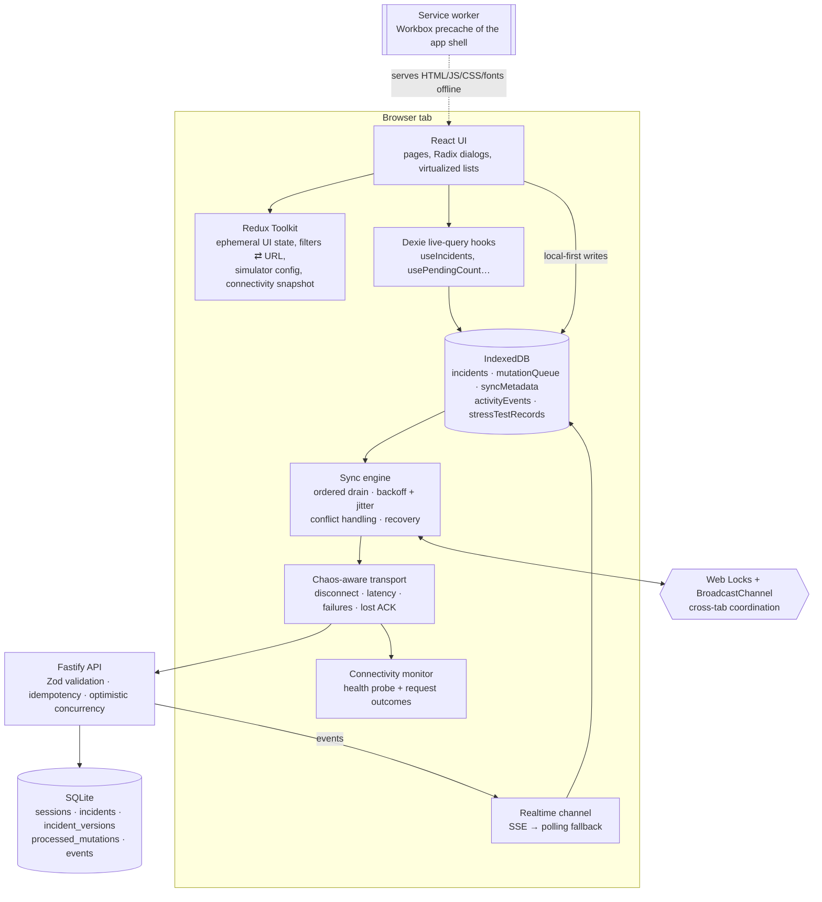

# Architecture

AIRGAP/01 is a pnpm monorepo with three packages:

| Package           | Role                                                                          |
| ----------------- | ----------------------------------------------------------------------------- |
| `packages/shared` | Zod schemas, TypeScript types, API contracts, fictional topology, seeded PRNG |
| `apps/server`     | Fastify API + SQLite (`node:sqlite`); also serves the built PWA in production |
| `apps/web`        | React 19 + Vite PWA: UI, IndexedDB (Dexie), mutation queue, sync engine       |



## Data ownership

There is exactly one owner for each kind of data — no conflicting duplicate copies.

| Data                                                                   | Owner                       | Why                                                               |
| ---------------------------------------------------------------------- | --------------------------- | ----------------------------------------------------------------- |
| Incidents (local view), mutation queue, cursor, session id, activity   | **IndexedDB** (Dexie)       | Must survive reloads and work offline; shared by every tab        |
| Filters, open panels, selections, simulator config, connectivity state | **Redux Toolkit**           | Ephemeral or derived UI state; filters are mirrored to the URL    |
| Form drafts, hover state, merge selections                             | React component state       | Local to one component                                            |
| Authoritative incidents and versions                                   | **SQLite** on the server    | The server assigns versions and decides conflicts                 |
| App shell (HTML, JS, CSS, fonts, icons)                                | **Service worker** precache | Lets the console boot with no network; never caches API responses |

Durable data is never copied into Redux. Components read IndexedDB through
Dexie `liveQuery` hooks (`apps/web/src/hooks/useLiveData.ts`), which re-run when
the underlying tables change — in this tab or another tab — so every view stays
consistent with the database.

## IndexedDB design (`apps/web/src/database/db.ts`)

| Table               | Key     | Indexes                                                                           |
| ------------------- | ------- | --------------------------------------------------------------------------------- |
| `incidents`         | `id`    | `status`, `severity`, `sectorId`, `updatedAt`, `syncStatus`, `deleted`            |
| `mutationQueue`     | `++seq` | `&id` (idempotency key, unique), `entityId`, `status`, `createdAt`, `nextRetryAt` |
| `syncMetadata`      | `key`   | — (session id, event cursor, last sync time/duration)                             |
| `activityEvents`    | `++id`  | `ts`, `type`, `category` (pruned to the latest 1,500)                             |
| `stressTestRecords` | `id`    | `status`, `severity`, `sectorId`, `updatedAt`, `nodeId`                           |

A local incident keeps the server fields plus local-only sync metadata:
`version` is **only ever a version the server acknowledged** (0 = not created
on the server yet), `syncStatus` is derived from outstanding mutations, and
`deleted = 1` is a local tombstone that hides the row until the server confirms
the delete.

## Frontend structure

```
apps/web/src
├── app/            runtime wiring (Runtime), boot store, service-worker registration
├── database/       Dexie schema, local-first commands (incidentStore), activity log
├── services/
│   ├── api/        transport (chaos-aware fetch), typed client, realtime (SSE)
│   ├── connectivity/  monitor + pure connection-state derivation
│   └── sync/       SyncEngine, MutationProcessor, RetryManager, ConflictResolver,
│                   SyncCoordinator, RemoteSync, mutation payload schemas
├── store/          Redux slices (ui, filters, simulator, connectivity, challenge, perf)
├── hooks/          live-query hooks, URL ⇄ filter sync, media queries
├── features/       pure filtering/sorting, load-test dataset + indexed queries
├── components/     layout, dashboard, incidents, map, sync, simulator, challenge…
└── pages/          route components (secondary pages are lazy-loaded)
```

`Runtime` (`app/runtime.ts`) is created once per tab outside React (so
StrictMode cannot double-boot it). Every write goes through it, so a local
write always also wakes the sync engine and notifies other tabs.

## Backend architecture (`apps/server`)

- **Fastify 5**, 32 KB body limit, Helmet (CSP, HSTS, nosniff…), per-route
  rate limits (mutations per session, session creation per IP), structured
  error envelope `{ error: { code, message, details? } }`, no stack traces.
- **SQLite via `node:sqlite`** (Node's built-in synchronous driver — same
  model as better-sqlite3, without a native build step). WAL mode;
  `BEGIN IMMEDIATE` transactions.
- **IncidentService** applies every write inside one transaction together
  with its idempotency record (see [OFFLINE_SYNC.md](./OFFLINE_SYNC.md)).
- **Events**: every committed change appends to an `events` table (global
  autoincrement cursor). `GET /api/events?after=` serves catch-up;
  `GET /api/events/stream` is an SSE stream that replays from the cursor and
  then pushes live events from an in-process bus (published only after COMMIT).
- **Demo sessions** isolate visitors. Each session is seeded with 26 fictional
  incidents; sessions idle for `DEMO_SESSION_TTL_DAYS` are deleted hourly. The
  session id is an opaque UUID that scopes fictional data — it is **not**
  authentication.

| Endpoint                                 | Purpose                                                  |
| ---------------------------------------- | -------------------------------------------------------- |
| `GET /api/health`                        | Liveness probe used for reachability                     |
| `POST /api/demo/sessions`                | Create + seed an isolated demo workspace                 |
| `GET /api/incidents[/:id]`               | Read (deleted → 410)                                     |
| `POST /api/incidents`                    | Create (client UUID; `Idempotency-Key` required)         |
| `PATCH /api/incidents/:id`               | Update with `baseVersion` (409 on stale)                 |
| `DELETE /api/incidents/:id?baseVersion=` | Tombstone delete (409 on stale)                          |
| `GET /api/events`, `/api/events/stream`  | Change feed: polling and SSE                             |
| `POST /api/demo/remote-edit`             | Demo-only server-side edit (creates a real version bump) |
| `POST /api/demo/reset`                   | Reseed the caller's session only                         |

## Service worker behaviour

`vite-plugin-pwa` (Workbox `generateSW`) precaches every built asset — HTML,
all JS chunks including lazy routes, CSS, the bundled Geist fonts, icons and
the manifest. Navigations fall back to the cached `index.html`, except `/api/*`
which is never handled by the SW. Updates use **prompt** mode: a new version is
downloaded in the background and an "update ready — reload" banner lets the
user choose when to switch (`clientsClaim` makes the very first install control
the page immediately). The server sends `Cache-Control: no-cache` for HTML,
`sw.js` and the manifest, and `immutable` for hashed `/assets/*`.

The service worker caches the **application shell**; IndexedDB persists the
**application data**. They are separate concerns.

## State management decisions

- **Redux Toolkit** only for state that is ephemeral, derived, or needs to be
  addressable (URL filters). The simulator config is persisted to
  `localStorage` (so a simulated disconnect survives reloads) and synchronised
  across tabs with the `storage` event.
- **Dexie live queries** instead of a Redux cache for durable data — avoids a
  second copy that could drift from IndexedDB, and gives cross-tab reactivity.
- Connection state is a **pure derivation** (`deriveConnection`) of browser
  online state, simulated disconnect, backend reachability and engine phase.

## Synchronization responsibilities

| Module                 | Responsibility                                                                        |
| ---------------------- | ------------------------------------------------------------------------------------- |
| `incidentStore.ts`     | Local-first commands; incident + mutation written in one transaction                  |
| `SyncEngine.ts`        | When/what to send; ordering; per-entity blocking; backoff scheduling; recovery        |
| `MutationProcessor.ts` | Send one mutation; translate result; apply outcome atomically; rebase later mutations |
| `RetryManager.ts`      | Backoff formula and error classification                                              |
| `ConflictResolver.ts`  | Keep mine / accept server / merge; retry or discard failed mutations                  |
| `RemoteSync.ts`        | Session creation, full refresh, event application, cursor                             |
| `SyncCoordinator.ts`   | Cross-tab lock and messages                                                           |
| `ConnectivityMonitor`  | Backend reachability from health probes and real request outcomes                     |

## Cross-tab coordination

- **Web Locks** (`navigator.locks.request('airgap-01:sync', { ifAvailable: true })`)
  guarantee one tab drains the queue at a time. The lock is released
  automatically if the tab crashes or reloads. Where Web Locks are unavailable
  a renewable `localStorage` lease (8 s, renewed every ~2.7 s) is used.
- Demo-session creation uses a **waiting** Web Lock so two tabs opened at the
  same moment cannot create two sessions.
- **BroadcastChannel** tells other tabs to re-check the queue after a local write.
- Dexie live queries propagate data changes to all tabs.
- The server's idempotency keys remain the final safeguard.

## Map rendering

The operations map is a custom SVG of a fictional region (8 sector polygons,
32 nodes, bundled in `packages/shared/src/topology.ts`). Incidents attach to a
node in their sector via a stable hash of their id. Rendering always draws
32 markers regardless of dataset size — incidents are aggregated per node in
one O(n) pass (`summarizeNodes`), which is what keeps the 1,000-record load
test cheap. Zoom/pan is a single SVG transform; nodes are focusable buttons and
a keyboard-accessible node list mirrors the map.
