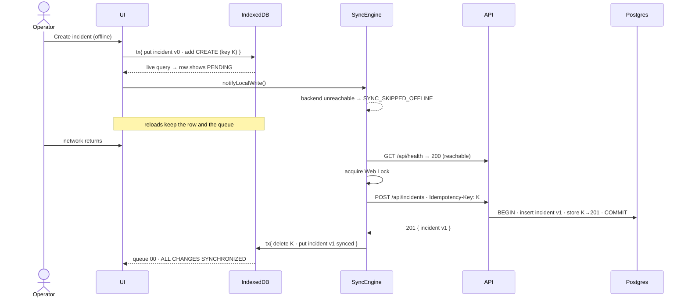
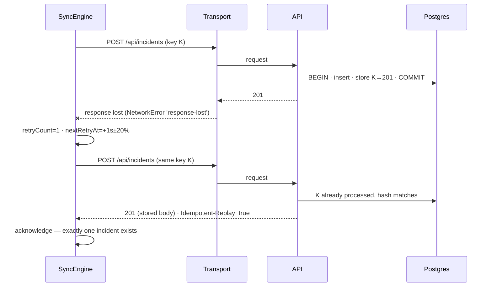
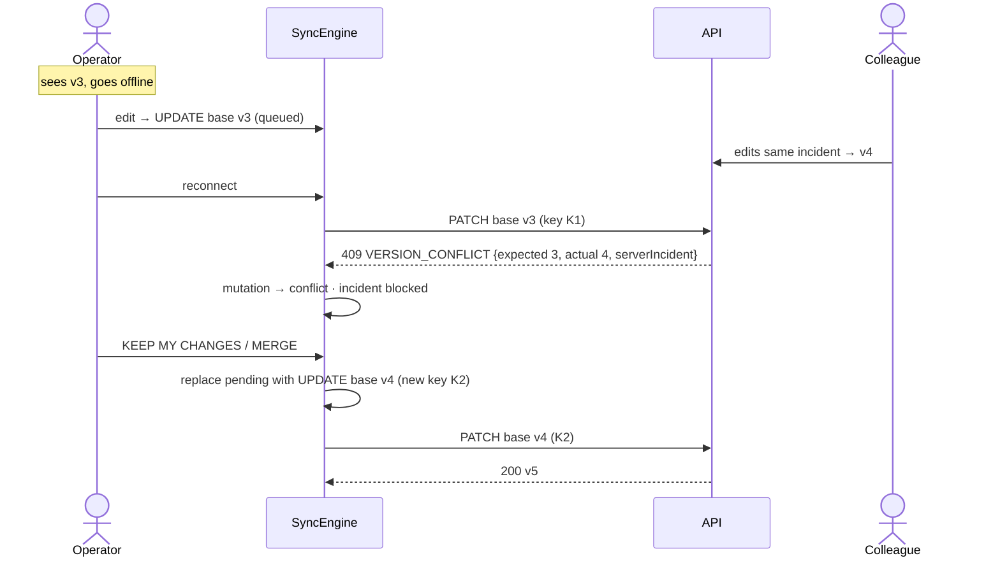

# Offline-first writes and synchronization

## 1. Local-first writes

Every create, update and delete goes to IndexedDB first
(`apps/web/src/database/incidentStore.ts`). In **one** Dexie transaction the
command:

1. validates the fields with the shared Zod schema,
2. writes the incident (new rows get a client-generated UUID and `version: 0`),
3. appends a mutation to `mutationQueue` with a fresh UUID **idempotency key**,
4. records activity events.

The UI updates immediately through live queries. The network is not involved;
the sync engine is merely woken up afterwards. This is identical online and
offline.

## 2. The durable queue

```ts
interface QueuedMutation {
  seq: number; // processing order (auto-increment)
  id: string; // Idempotency-Key — never changes across retries
  type: 'CREATE_INCIDENT' | 'UPDATE_INCIDENT' | 'DELETE_INCIDENT';
  entityId: string;
  payload: unknown; // re-validated with Zod before every send
  baseVersion?: number; // server version the change was based on
  status: 'queued' | 'syncing' | 'conflict' | 'failed';
  attempts: number; // >0 ⇒ the server MAY already have applied it
  retryCount: number; // failed attempts since last success (drives backoff)
  nextRetryAt?: string;
  lastError?: string;
  conflict?: ConflictDetails;
}
```

**Ordering and dependencies.** The engine drains strictly in `seq` order. For a
given incident nothing is sent while an earlier mutation for it is unacknowledged,
in conflict or failed — an UPDATE can never overtake its CREATE. Other incidents
keep flowing.

**Rebasing.** An UPDATE made while its CREATE (or an earlier UPDATE) is still
queued is recorded against the last acknowledged version. When the earlier
mutation is acknowledged with version _v_, every later mutation for that
incident is rebased to `baseVersion = v` in the same transaction — they were all
made on top of it. The client never invents a version.

**Delete after create.** If an incident created offline is deleted before its
CREATE was ever sent (`attempts === 0`), the queued mutations and the row are
removed locally and nothing is sent. Otherwise a DELETE is queued and the row
becomes a tombstone (`deleted = 1`) so it cannot reappear on refresh.

**Removal only after acknowledgement.** A mutation is deleted from the queue in
the same transaction that writes the server's acknowledged state locally.

## 3. Reachability

`navigator.onLine` is necessary but not sufficient. The app is "connected" only
when the browser is online **and** the simulated disconnect is off **and** the
backend answered a health probe or a real request
(`services/connectivity`). Real request failures trigger an immediate re-probe.
States: `CONNECTED`, `OFFLINE` (reason: browser / simulated / backend
unreachable), `CHECKING`, `DEGRADED` (recent failures or measured latency

> 1.2 s), `SYNCHRONIZING`, `SYNC_ERROR`.

## 4. Retry policy (`RetryManager.ts`)

| Failure                                  | Action                                      |
| ---------------------------------------- | ------------------------------------------- |
| Network error, timeout, lost response    | Retry with backoff                          |
| HTTP 408 / 425 / 429 / 5xx               | Retry with backoff                          |
| HTTP 409 `VERSION_CONFLICT`, 410 deleted | Mark `conflict`, ask the user               |
| HTTP 401 `SESSION_NOT_FOUND`             | Create a new demo session, continue         |
| Other 4xx (validation), invalid payload  | Mark `failed`, no automatic retry, surfaced |

Backoff: `min(30 s, 1 s × 2^(n−1)) ± 20 % jitter` → ~1 s, 2 s, 4 s, 8 s, 16 s,
30 s, 30 s… After 8 automatic retries the mutation is parked as `failed`; the
user can **Retry failed** or discard it. A retryable failure stops the current
pass (the network is probably down for everything behind it) and schedules the
next attempt at `nextRetryAt` — no tight loops. Returning connectivity or
**Sync now** forces an immediate attempt.

## 5. Idempotency

Every write carries `Idempotency-Key: <mutation.id>`. On the server
(`apps/server/src/services/incidentService.ts`), inside one transaction that first
row-locks the demo session:

1. look up `(session_id, mutation_id)` in `processed_mutations`;
2. if present and the request hash matches → return the stored status/body with
   `Idempotent-Replay: true` (if the hash differs → 422 `IDEMPOTENCY_KEY_REUSED`);
3. otherwise apply the change and store the response **in the same transaction**.

Failed attempts (409, 400…) change nothing and are not stored; the client
resolves them with a brand-new mutation id.

## 6. Versions and conflicts

The server assigns `version` (1 on create, +1 per update/delete). Updates and
deletes must carry `baseVersion`; the check is part of the `UPDATE … WHERE
version = ?` statement, so check-and-write is atomic. A stale write gets:

```json
{
  "error": {
    "code": "VERSION_CONFLICT",
    "message": "…",
    "details": {
      "incidentId": "…",
      "expectedVersion": 3,
      "actualVersion": 4,
      "serverIncident": { "…": "current authoritative copy" },
      "deleted": false
    }
  }
}
```

The engine marks the mutation `conflict` and blocks only that incident. The
**SYNC CONFLICT DETECTED** dialog shows a field-level diff:

- **Keep my changes** — replaces all of the incident's pending mutations with
  ONE new UPDATE (new idempotency key) containing the local values that differ
  from the server, based on the server's current version, at the same queue
  position.
- **Accept server version** — discards the incident's pending mutations and
  stores the server copy locally.
- **Review & merge** — choose per field (mine / server, editable), then queue
  one UPDATE of the merged values on top of the server version.

If the server copy was deleted (410), "keep mine" re-creates the incident under
a new id. Nothing is ever overwritten silently.

## 7. Recovery after reload or crash

Everything needed to continue is persisted: incidents, queue, event cursor,
session id, simulator config. At the start of every pass, the lock-holding tab
re-queues mutations left in `syncing` (only the lock holder ever sets that
status, so any it finds were interrupted). They are resent with their original
idempotency keys — if the server had already applied them, it replays the
stored result.

## 8. Pulling remote changes

After pushing, the engine pulls `GET /api/events?after=<cursor>`. Live updates
arrive over SSE (`/api/events/stream`, resumes from the cursor; falls back to
polling every 10 s and retries SSE every 30 s). A server change is applied to a
local record **only if it has no pending mutations**; otherwise the pending
mutation will meet a 409 and the user decides. A `session.reset` event or a
cursor older than the session's history floor triggers a full refresh.

## Sequence diagrams

### Offline create and reconnect



### Lost acknowledgement and retry



### Version conflict and resolution



## Known consistency limitations

- Conflict detection is per record (whole-incident version), not per field; the
  merge UI preserves field-level intent manually. Non-overlapping concurrent
  edits still raise a conflict.
- Pending local changes hide newer remote changes for that incident until the
  pending mutation is resolved (by design — no silent overwrite).
- The SSE stream bypasses the simulated transport; it is closed while the
  simulated disconnect is active, but latency/failure injection do not apply to it.
- Activity history is local to the browser and pruned to 1,500 events.
- If a demo session expires on the server while changes are pending, pending
  CREATEs are replayed into a new session, but UPDATE/DELETEs for incidents of
  the old session fail with 404 and are surfaced as `failed`.
- Demo sessions are scoping, not authentication.
